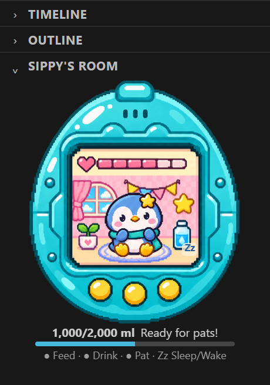
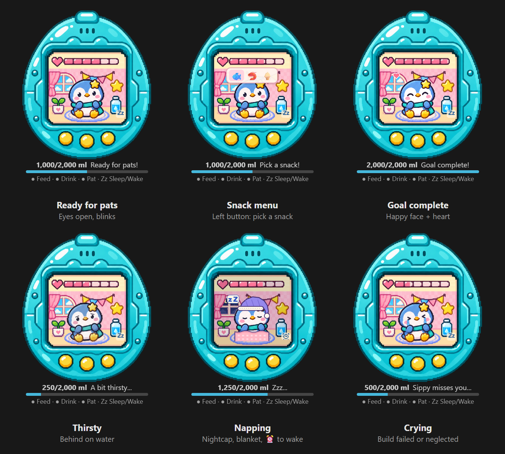

# Sippy: Cozy Hydration Pet for VS Code

Sippy is a tiny penguin who lives in a turquoise virtual-pet egg in your **Explorer sidebar**. Log your water, feed her snacks, pat her, and tuck her in for a nap. She reacts while you code: errors startle her, fixes and commits make her cheer. Drink enough and she glows; forget about her and she gets thirsty.

<p align="center">
  
</p>

## Install

1. In VS Code, open the **Extensions** view (`Ctrl+Shift+X`).
2. Search for **Sippy Virtual Hydration Pet** and click **Install**.

## Find Sippy

1. Open the **Explorer** (`Ctrl+Shift+E`).
2. Expand **Sippy's Room** at the bottom.
3. Optional: drag the section header to move it (for example, below Timeline), or drag its border to resize it.

## Use Sippy

<p align="center">
  
</p>

### The buttons

| Button | What it does |
|---|---|
| **Left** yellow button | Opens the **snack menu**. Pick one: 🐟 fish (very filling), 🦐 shrimp (filling and tasty), 🍦 ice cream (a happy treat). |
| **Middle** yellow button | Logs **250 ml** of water. |
| **Right** yellow button | **Pats** Sippy on the head. It makes her happy and doesn't tire her out. |
| **Zz** / **⏰** on the screen | Puts her down for a **nap**; while she sleeps the button shows a little pixel **alarm clock** that wakes her. Also **Sippy: Put to Sleep / Wake Up** in the Command Palette. Asleep, she regains about 1 energy a minute and wakes by herself when fully rested (at night she sleeps through until 6:00). She can nap whenever she isn't fully rested. Press Zz again, feed her or pat her to wake her early. She naps through saves and commits, but code errors still startle her. |
| Click **Sippy** | She waves hello. |

### Her health bar

The **❤️ health bar** (6 segments) shows how Sippy is doing overall, and your water intake is a big part of it:

- **40% hydration:** how much of today's goal you've drunk so far. Drinking fills it right away; falling behind pace (8:00 to 22:00) pulls it down.
- **60% care:** the average of hunger, happiness and energy. Feeding, patting and resting raise it, and it drains slowly over a few hours.

Every day starts at **2 of 6 segments**: water and care fill it from there.

Today's water total is shown under the egg.

Hover over the egg to see the exact numbers.

### Her moods

| Mood | When it happens |
|---|---|
| Eyes open, blinking | Normal |
| Night sky in the window | 19:00 to 6:00 |
| Happy `^ ^` with a ♥ | You care for her, save a file, a build passes, you commit, or you reach your goal |
| Thirsty (droopy, sad eyes) | You're more than 20% behind where you should be for the time of day (paced from 8:00 to 22:00) |
| Sleepy (droopy, a bit dim, eyes still open) | Low energy, or late at night (23:00 to 5:00). Press **Zz** to put her to bed |
| Napping `∪ ∪` with "z Z" | After you press **Zz**: she wears a nightcap, snuggles under her blanket, and the button turns into a ⏰ |
| Worried | New errors appear in your code ("Oops, an error!", or "So many errors..." at 5 or more) |
| Crying `> <` with tears | A build or task fails, or she's been neglected for a few days |

She always breathes gently and only moves briefly when she reacts. If your system has **reduce motion** turned on, she stays still.

### Sounds

Sippy makes tiny retro sounds: bloops when she drinks, nom-nom when she eats, a chirp when you save, a lullaby when she rests, a jingle on commits and a fanfare when you hit your goal. VS Code only allows sound after you **click inside Sippy's Room once** after starting VS Code.

### Reminders

While VS Code is open, Sippy reminds you to drink every 45 minutes until you reach your goal. Click **Log 250 ml** in the reminder to log a drink without opening her room.

## Commands

Open the Command Palette (`Ctrl+Shift+P`) and type "Sippy":

| Command | What it does |
|---|---|
| **Sippy: Open Pet Room** | Opens the Explorer and focuses Sippy's Room |
| **Sippy: Log Water** | Log a custom amount (1 to 2000 ml) |
| **Sippy: Feed Sippy** | Choose a snack from a list |
| **Sippy: Put to Sleep / Wake Up** | Put her down for a nap, or wake her up |
| **Sippy: Toggle Sound** | Turn her sounds on or off |
| **Sippy: Reset Today's Water** | Set today's total back to 0 |

## Settings

Open Settings (`Ctrl+,`) and search for **sippy**:

| Setting | Default | What it does |
|---|---|---|
| `sippy.dailyGoal` | `2000` | Daily water goal in ml |
| `sippy.reminderMinutes` | `45` | Minutes between reminders (5 to 240) |
| `sippy.remindersEnabled` | `true` | Show hydration reminders |
| `sippy.codingReactions` | `true` | React to saves, builds, commits and errors |
| `sippy.sound` | `true` | Play Sippy's sounds |
| `sippy.soundVolume` | `40` | Sound volume, 0 to 100 |

## Privacy

Everything is stored locally in VS Code. Sippy has no accounts, telemetry, network requests or dependencies.

## Limits

- Reminders only run while VS Code is open. Sippy isn't a system-wide reminder app.
- VS Code may pause her animations while her view is hidden.
- VS Code decides the exact height of the Explorer section. Sippy's egg shrinks to fit short views.
- The git commit reaction needs VS Code's built-in Git extension.

## For developers

Run the extension from source:

1. Open this folder in VS Code.
2. Press **F5** and choose **Run Sippy Extension** if asked. A second VS Code window (the Extension Development Host) opens with Sippy loaded.
3. After changing `extension.js`, restart it with **Shift+F5** and then **F5**. Changes to `media/room.html` show up when you run **Developer: Reload Window** in that second window.

Run the tests:

```bash
node tests/test-extension.cjs
```

### Project layout

| Path | Contents |
|---|---|
| `extension.js` | Extension logic: water, pet stats, reminders, coding reactions, commands |
| `media/room.html` | Sippy's Room webview: layout, faces, animations, sounds |
| `media/room-egg.png` | The egg and room artwork |
| `media/sippy-faces.png` | Sprite sheet with 6 faces: happy, open, blink, sleep, sad, cry |
| `media/bar-health.png` | Full-bar layer for the live health bar |
| `media/window-night.png` | Night-sky window layer, shown from 19:00 to 6:00 |
| `media/nightcap.png`, `media/blanket.png` | Sleepwear layers shown while she naps |
| `sippy-cozy-reference.png` | The original design reference |
| `docs/` | README screenshots, captured from the real `room.html` (not included in the `.vsix`) |

Repository: https://github.com/Noblesse013/sippy-vscode-pets

See [CHANGELOG.md](CHANGELOG.md) for version history.
