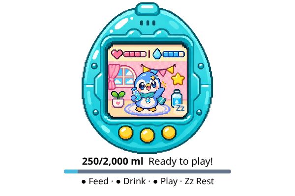

# Sippy — Cozy Virtual Hydration Pet for VS Code

Sippy is a tiny pixel penguin in a cozy turquoise virtual-pet egg, designed for a **narrow VS Code Explorer panel**. Inspired by the space used by VS Code Pets, but built independently with original assets. Sippy sits beside Outline and Timeline, not inside the VS Code Pets extension.



## Features
- Compact, height-responsive Explorer view (device up to **182 CSS pixels wide**, shrinking to fit shorter view heights)
- Animated Sippy, always animated while her view is visible (unless VS Code suspends the webview)
- Three buttons on her egg: **left Feed**, **middle Log 250 ml**, **right Play**; **Zz** in the display lets Sippy rest
- Hunger, happiness, and energy slowly change over time; care actions improve Sippy's condition
- Daily water logging with hard goal cap, configurable goal, and optional reminders while VS Code runs
- **Coding reactions**: Sippy waves on save, cheers when a task passes, worries when it fails or errors pile up, and dances on git commits (`sippy.codingReactions` to turn off)
- **Mood follows your pace**: Sippy gets a little droopy and thirsty when you fall behind your expected intake for the time of day, and sleepy late at night
- VS Code local `globalState` storage. No telemetry, accounts, dependencies, or external requests

## Try it
1. Open this folder in VS Code.
2. Press **F5** and select **Run Sippy Extension** if prompted.
3. In the Extension Development Host, open Explorer (`Ctrl+Shift+E`).
4. Expand **Sippy's Room**. Drag the section to your preferred place, such as below Timeline. Resize the view by dragging its border.
5. Press left yellow button to feed Sippy, middle to log 250 ml, right to play; click **Zz** inside the screen to rest.
6. To change the daily water target/reminder interval, open Settings and search **sippy**.

## Testing

```bash
node tests/test-extension.cjs
```

## Install locally in your main VS Code

```bash
npx @vscode/vsce package
```

From VS Code's Extensions panel `...` menu choose **Install from VSIX...**, and select the generated `.vsix`.

## Publish to Visual Studio Marketplace

You must first [create a Marketplace publisher](https://code.visualstudio.com/api/working-with-extensions/publishing-extension), replace the placeholder `local-dev` in package.json with your real publisher ID, and publish using `vsce` after authentication. Review the README, LICENSE, screenshots, publisher branding, and store listing before publishing. A public GitHub repository alone does not list the extension in the Marketplace.

```bash
git init
git add .
git commit -m "Build compact Sippy VS Code pet"
git branch -M main
# create a GitHub repo, then set its URL:
git remote add origin https://github.com/Noblesse013/sippy-vscode-pet.git
git push -u origin main
```

## Limits
- VS Code cannot guarantee an exact Explorer view height. The UI uses CSS to resize to the actual available space, targeting a VS Code Pets-sized view.
- Visual animation runs while Sippy's view is active; VS Code may suspend animations when the view is hidden.
- Reminders operate only while VS Code runs; not an OS-wide background service.
- This VS Code pet does not automatically share Chrome Siply water history.

## Cozy redesign (v0.4.0)
The refreshed device art uses the approved pastel-pink room and turquoise egg design.
The source illustration is included as `sippy-cozy-reference.png`.
The extension uses `media/sippy-egg.png` (an animation-ready version with an empty room) together with `media/sippy.png` for Sippy's independent idle/care animations.
The three egg buttons remain interactive and the compact Explorer layout still scales down for small views.

Repository: https://github.com/Noblesse013/sippy-vscode-pet (create this repository before pushing).

## Packaging fix (v0.4.1)
`package.json` now declares the GitHub repository so `vsce package` can resolve README image paths. You can package locally before creating the remote repository. The tests are independent of VSIX packaging.
